# Kết quả thực nghiệm

## E01 — QBER khi Eve chặn–phát lại

Ghép lỗi chặn–phát lại và lật bit qua XOR. Các điểm Aer dùng cỡ mẫu nhỏ hơn. Có 5/46 điểm có mốc nằm ngoài khoảng tin cậy riêng lẻ. Các khoảng chưa hiệu chỉnh cho nhiều phép so sánh.

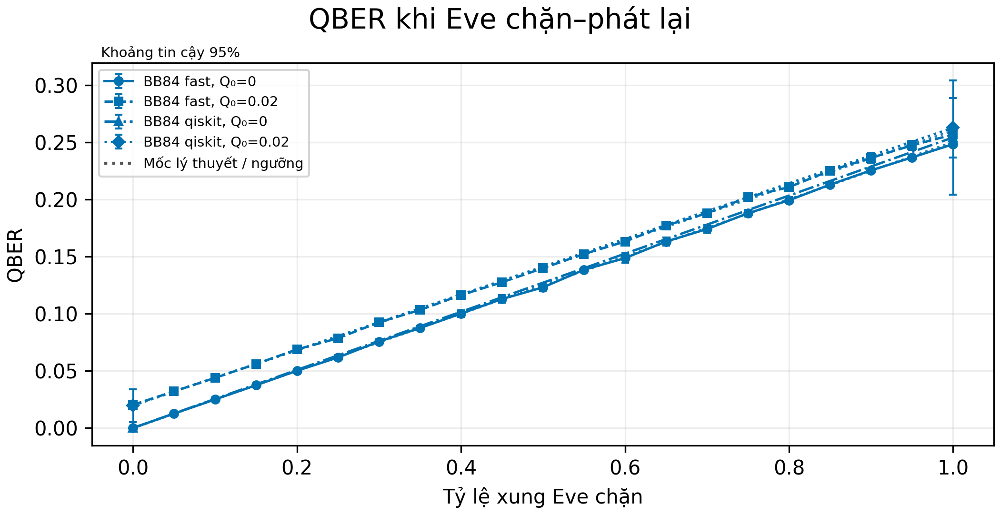

[CSV](E01_qber_eve.csv) · [PDF](E01_qber_eve.pdf) · [Nguồn gốc](E01_qber_eve.json)

## E02 — Dung sai nhiễu BB84

Cận Hoeffding làm phiên dừng sớm hơn ngưỡng QBER tiệm cận. Tỷ lệ dừng còn tính trường hợp độ dài khóa hữu hạn không dương. BB84 Qmax=0.08 dừng mọi lượt lần đầu tại Q=0.04. BB84 Qmax=0.11 dừng mọi lượt lần đầu tại Q=0.08.

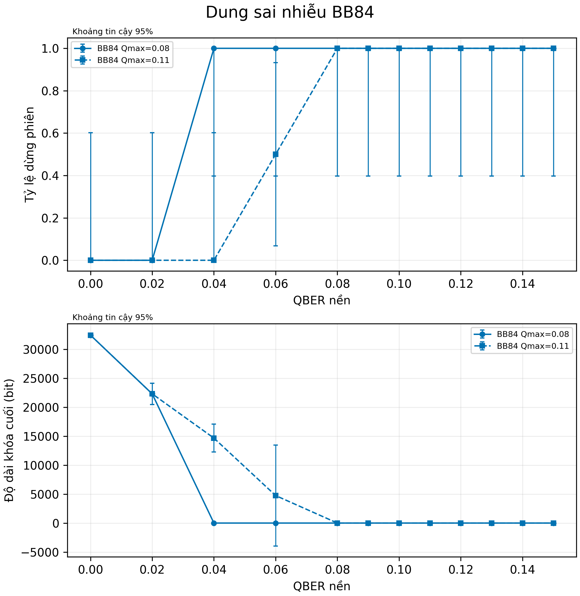

[CSV](E02_noise_abort.csv) · [PDF](E02_noise_abort.pdf) · [Nguồn gốc](E02_noise_abort.json)

## E03 — Phát hiện Eve qua mẫu công khai

Báo phát hiện khi mẫu lý tưởng có ít nhất một bit sai. Phép thử này dùng mô hình nhị thức với Eve chặn toàn phần. Có 0/6 điểm có mốc nằm ngoài khoảng tin cậy riêng lẻ. Các khoảng chưa hiệu chỉnh cho nhiều phép so sánh.

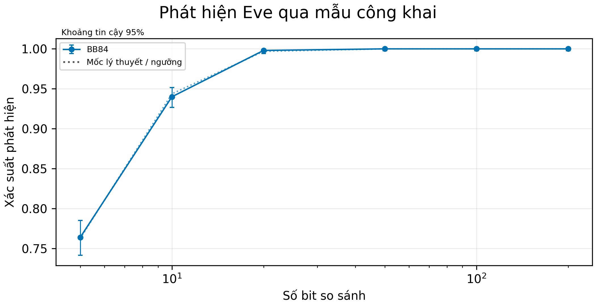

[CSV](E03_sample_detection.csv) · [PDF](E03_sample_detection.pdf) · [Nguồn gốc](E03_sample_detection.json)

## E04 — Các bước tạo khóa BB84

Sàng lọc giữ số bit đo được. Các bước sau ghi không bit khi phiên dừng. Hệ số Cascade chỉ tính trên các phiên hiệu chỉnh có entropy mẫu dương. Độ dài cuối được tính từ lượng rò quan sát và chi phí xác minh. BB84 Q=0.01 có 0 bước giảm độ dài trung bình trên lưới. BB84 Q=0.03 có 0 bước giảm độ dài trung bình trên lưới. BB84 Q=0.05 có 0 bước giảm độ dài trung bình trên lưới. BB84 Q=0.08 có 0 bước giảm độ dài trung bình trên lưới.

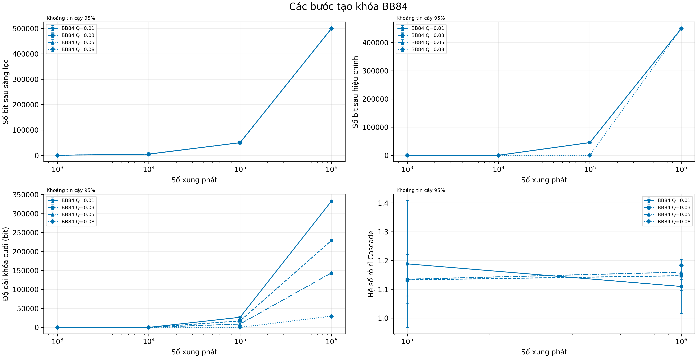

[CSV](E04_key_pipeline.csv) · [PDF](E04_key_pipeline.pdf) · [Nguồn gốc](E04_key_pipeline.json)

## E05 — Tổn thất do khóa hữu hạn

Mốc tiệm cận có cùng tỷ lệ sàng lọc và tỷ lệ bit công khai. Cận QBER, thẻ xác minh và ngân sách bí mật làm giảm tốc độ khóa hữu hạn. Tại N=1000000, tốc độ đo là 0.2398, mốc tiệm cận là 0.275 bit/xung.

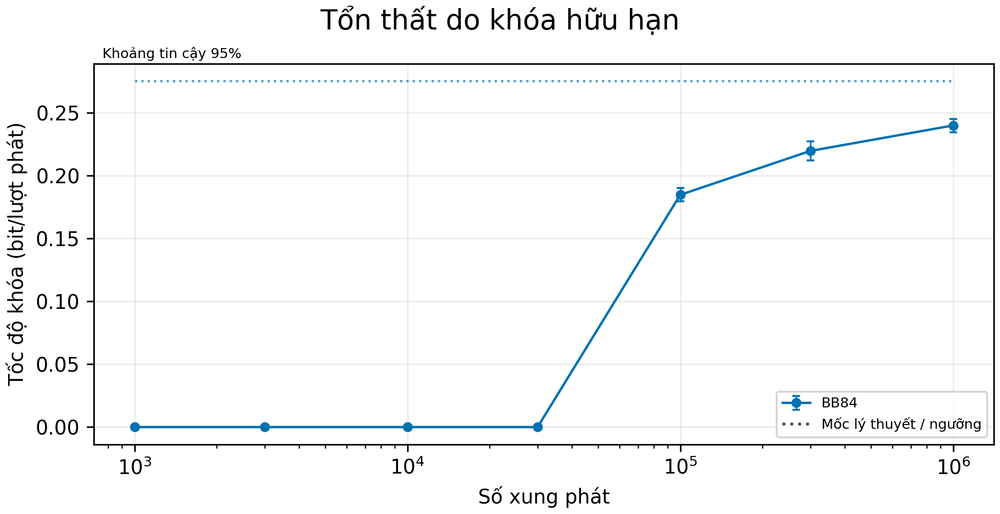

[CSV](E05_finite_key.csv) · [PDF](E05_finite_key.pdf) · [Nguồn gốc](E05_finite_key.json)

## E06 — Tốc độ khóa theo chiều dài sợi

Đường tiệm cận dùng mô hình suy hao và đếm tối, khoảng cách tính theo mỗi nhánh. Đường BB84 xung yếu là ước lượng lạc quan bỏ qua PNS. Đường mồi dùng cận chân không + mồi yếu. E91 tính theo cặp phát. Mô hình BB84 WCP cho điểm triệt tiêu khoảng 205.40 km. Mô hình BB84 decoy cho điểm triệt tiêu khoảng 194.88 km. Mô hình E91 cho điểm triệt tiêu khoảng 204.13 km.

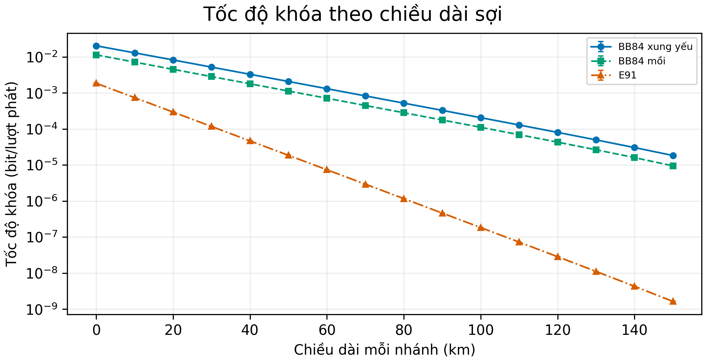

[CSV](E06_distance.csv) · [PDF](E06_distance.pdf) · [Nguồn gốc](E06_distance.json)

## E07 — Kiểm định Bell của E91

Cổng Bell dùng cận dưới CHSH và ngưỡng 2. QBER lấy từ toàn bộ cặp giữ khóa. Chặn–phát lại Z/X toàn phần làm giảm tương quan còn một nửa. Có 5/32 điểm có mốc nằm ngoài khoảng tin cậy riêng lẻ. Các khoảng chưa hiệu chỉnh cho nhiều phép so sánh. Có 0/40 lượt Eve cho |S| > 2. Với V=1, E91 fast, Eve=0 cho S=2.8255. Với V=1, E91 fast, Eve=1 cho S=1.4293. Với V=1, E91 qiskit, Eve=0 cho S=2.8192. Với V=1, E91 qiskit, Eve=1 cho S=1.4767.

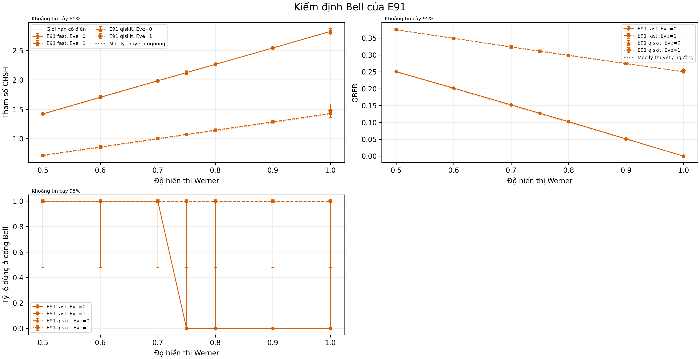

[CSV](E07_chsh.csv) · [PDF](E07_chsh.pdf) · [Nguồn gốc](E07_chsh.json)

## E08 — So sánh BB84 và E91

Tỷ lệ sàng lọc tính trên lượt dò hoặc cặp trùng phùng. Tỷ lệ dừng bao gồm toàn bộ quy trình. Cột bell_rejections đếm các lượt E91 dừng tại cổng Bell. Tốc độ tính cả các phiên không tạo khóa. Thời gian đo trên backend NumPy với EC lý tưởng. BB84 dùng nguồn đơn photon và đồng bộ cơ sở phát–đo. E91 cần nguồn cặp rối, hai nhánh quang và đo trùng phùng để ước lượng CHSH. E6 so sánh mô hình tốc độ theo khoảng cách. Có 0/28 điểm có mốc nằm ngoài khoảng tin cậy riêng lẻ. Các khoảng chưa hiệu chỉnh cho nhiều phép so sánh.

So sánh tại xác suất lật bit nền 0.

| Giao thức | Sàng lọc | Phiên dừng | Bit/lượt phát | ms/phiên |
|---|---:|---:|---:|---:|
| BB84 Eve=0 | 49.96% | 0.00% | 0.3234 | 54.7 |
| BB84 Eve=1 | 50.03% | 100.00% | 0 | 67.3 |
| E91 Eve=0 | 22.06% | 0.00% | 0.123 | 23 |
| E91 Eve=1 | 22.06% | 100.00% | 0 | 26.7 |

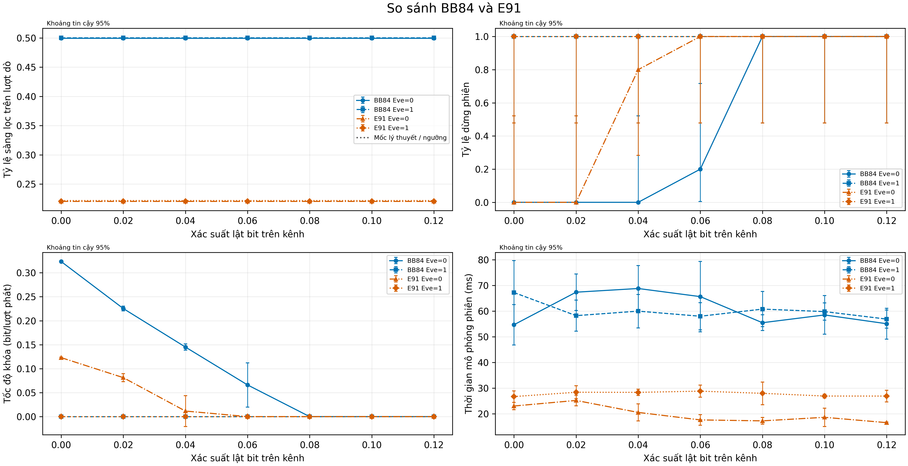

[CSV](E08_protocol_comparison.csv) · [PDF](E08_protocol_comparison.pdf) · [Nguồn gốc](E08_protocol_comparison.json)

## E09 — Hiệu năng mã hóa tệp QKDH

Trung vị và IQR tính sau một lượt làm nóng cho từng cấu hình. Phép đo gồm I/O tệp, HKDF và chia khối. Hỗ trợ AES-NI và tải máy ảnh hưởng kết quả.

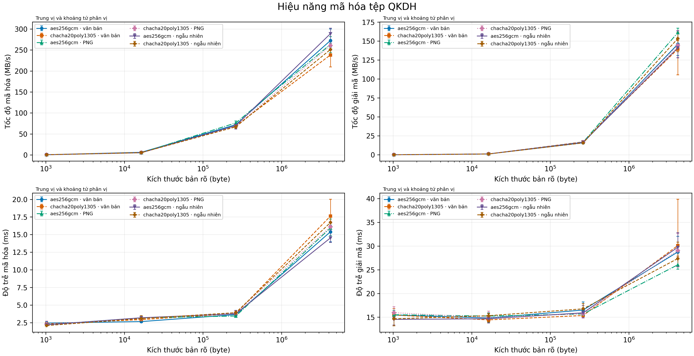

[CSV](E09_cipher_benchmark.csv) · [PDF](E09_cipher_benchmark.pdf) · [Nguồn gốc](E09_cipher_benchmark.json)

## E10 — Quy trình phân phối khóa và mã hóa tệp

Mỗi lượt dùng một phiên BB84 có HMAC. Đối chiếu SHA-256 trên tệp đã giải mã. Thời gian mã hóa và giải mã chỉ tổng hợp các phiên đã tạo khóa. Số lượt ghi nhận theo điều kiện. aes256gcm / text 3/3 · chacha20poly1305 / text 3/3 · aes256gcm / PNG 3/3 · chacha20poly1305 / PNG 3/3 · aes256gcm / random 3/3 · chacha20poly1305 / random 3/3.

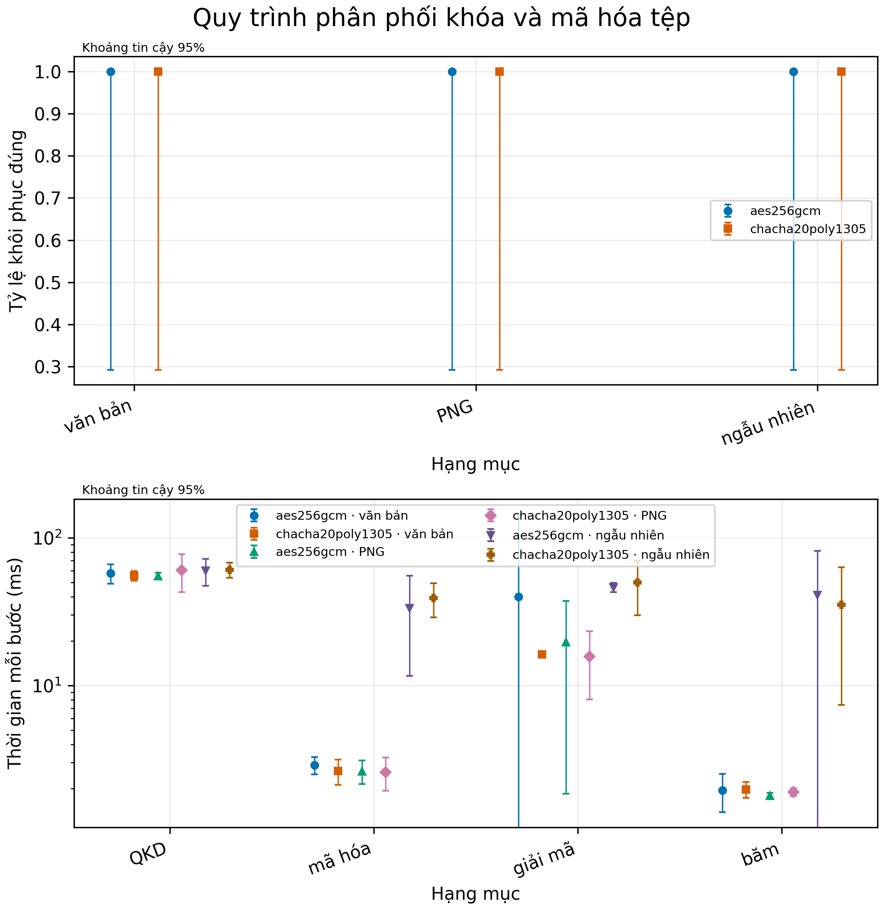

[CSV](E10_end_to_end.csv) · [PDF](E10_end_to_end.pdf) · [Nguồn gốc](E10_end_to_end.json)

## E11 — Toàn vẹn dữ liệu và tái sử dụng nonce

Mỗi lỗi sửa tệp được thử độc lập. Thí nghiệm cố ý lặp nonce trên dữ liệu giả để kiểm tra XOR bản rõ. Không lặp nonce trong sử dụng thực tế. Số lượt ghi nhận theo điều kiện. aes256gcm / header 30/30 · aes256gcm / ciphertext 30/30 · aes256gcm / tag 30/30 · aes256gcm / truncate 30/30 · aes256gcm / reorder 30/30 · aes256gcm / nonce reuse 30/30 · chacha20poly1305 / header 30/30 · chacha20poly1305 / ciphertext 30/30 · chacha20poly1305 / tag 30/30 · chacha20poly1305 / truncate 30/30 · chacha20poly1305 / reorder 30/30 · chacha20poly1305 / nonce reuse 30/30.

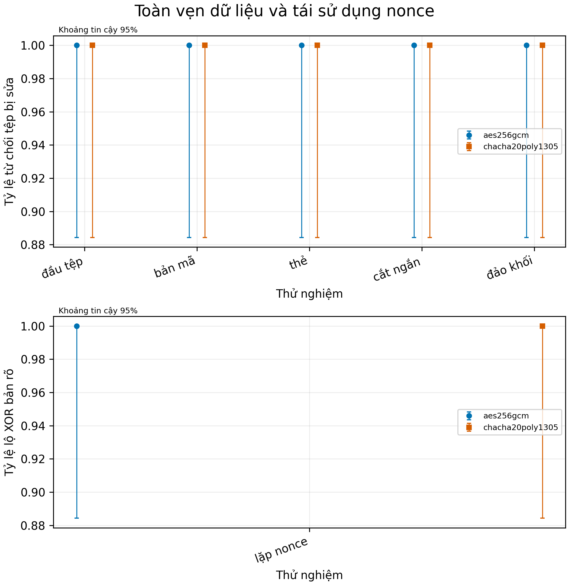

[CSV](E11_tamper.csv) · [PDF](E11_tamper.pdf) · [Nguồn gốc](E11_tamper.json)

## E12 — Xác thực kênh cổ điển

Eve chạy hai liên kết với hai đầu cuối. Cột both_tags_rejected đếm số lượt cả hai bên từ chối thẻ HMAC do Eve tạo. Số lượt ghi nhận theo điều kiện. BB84 / no HMAC 30/30 · BB84 / HMAC 0/30.

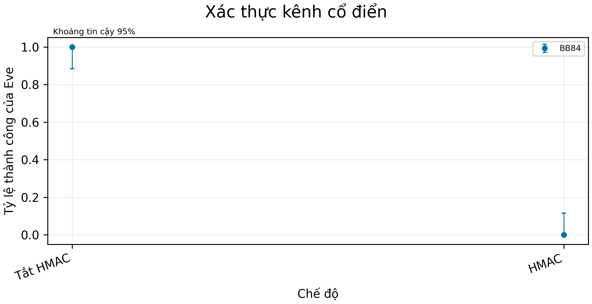

[CSV](E12_classical_mitm.csv) · [PDF](E12_classical_mitm.pdf) · [Nguồn gốc](E12_classical_mitm.json)

## E13 — Hiệu năng bộ giám sát

ROC quét ngân sách α hoặc ngưỡng Qmax. CI dùng cỡ mẫu cố định cho cùng giả thuyết thiết kế và mục tiêu α/β. Độ trễ chỉ tính ở lượt báo động kể từ bit đầu. Eve thích nghi dời toàn bộ lượt chặn về cuối, giữ tỷ lệ chặn trung bình. Ở điểm thiết kế, ci · Q₀=0.01 dùng trung bình 190.0 bit và báo động 200/200 lượt. Ở điểm thiết kế, sprt · Q₀=0.01 dùng trung bình 53.3 bit và báo động 199/200 lượt. Ở điểm thiết kế, ci · Q₀=0.03 dùng trung bình 437.0 bit và báo động 200/200 lượt. Ở điểm thiết kế, sprt · Q₀=0.03 dùng trung bình 140.4 bit và báo động 199/200 lượt. Mẫu ít lượt cần xét khoảng tin cậy trước khi so tỷ lệ lỗi.

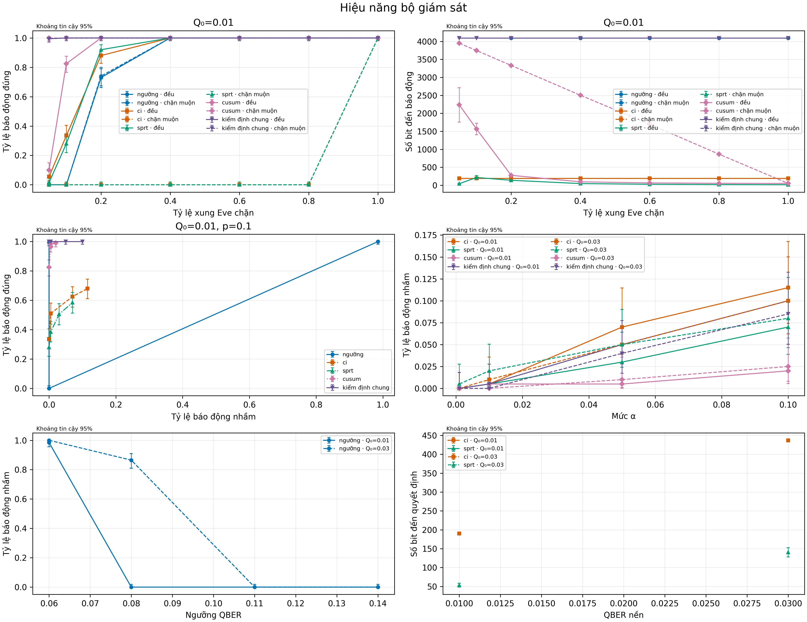

[CSV](E13_detectors.csv) · [PDF](E13_detectors.pdf) · [Nguồn gốc](E13_detectors.json)

## E14 — Chẩn đoán ngẫu nhiên trên chuỗi bit

SP 800-22 đo sai lệch trong mẫu. Aer lấy mẫu giả ngẫu nhiên qua mạch Hadamard. Một số phép thử có thể trượt ở mức α ngay trên nguồn không lệch. Có 0/25 điểm có mốc nằm ngoài khoảng tin cậy riêng lẻ. Các khoảng chưa hiệu chỉnh cho nhiều phép so sánh. Có 196/200 phép thử riêng lẻ đạt ngưỡng.

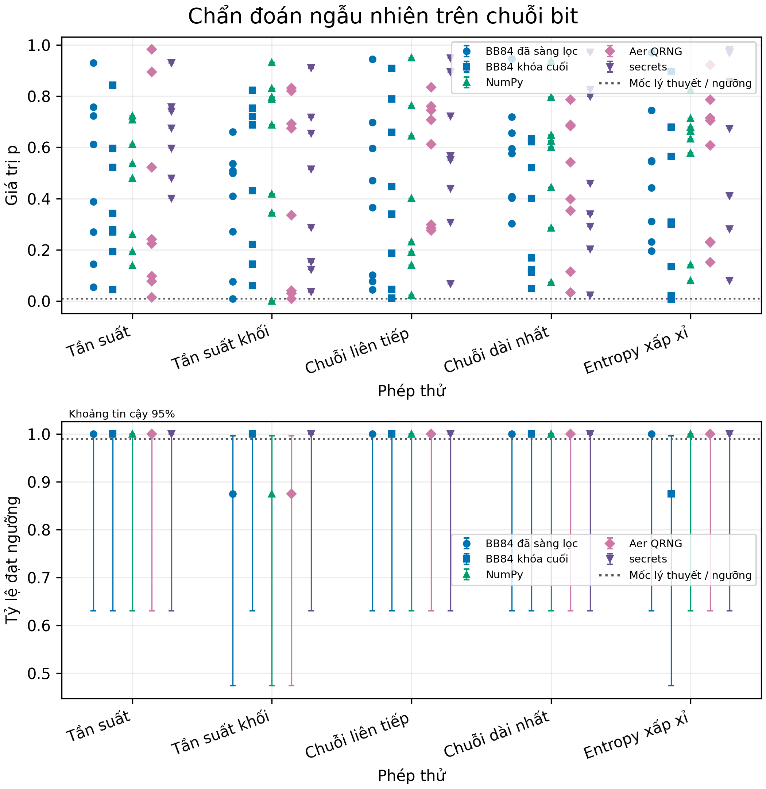

[CSV](E14_randomness.csv) · [PDF](E14_randomness.pdf) · [Nguồn gốc](E14_randomness.json)

## E15 — Chi phí tìm khóa cổ điển và lượng tử

Các hàng Grover ghi số mũ truy vấn tìm khóa. Các hàng Shor ghi mô hình đa thức và để trống số mũ. Chi phí cổng, độ sâu và sửa lỗi cần mô hình riêng.

| Thuật toán | Cỡ khóa (bit) | An toàn cổ điển (bit) | Tấn công lượng tử | Mô hình chi phí |
|---|---:|---:|---|---|
| AES-128 | 128 | 128 | Grover | Bậc 2^64 truy vấn |
| AES-256 | 256 | 256 | Grover | Bậc 2^128 truy vấn |
| ChaCha20 | 256 | 256 | Grover | Bậc 2^128 truy vấn |
| RSA-2048 | 2048 | 112 | Shor | Đa thức |
| ECC P-256 | 256 | 128 | Shor | Đa thức |

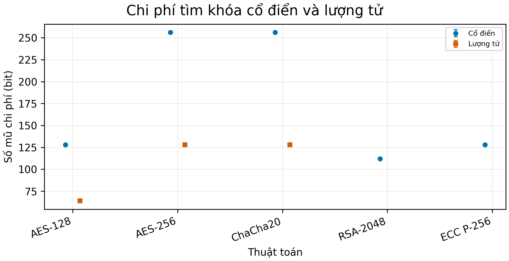

[CSV](E15_quantum_security.csv) · [PDF](E15_quantum_security.pdf) · [Nguồn gốc](E15_quantum_security.json)
