# Phân phối khóa lượng tử và mã hóa xác thực

## 1. Mở đầu

Mô tả cách Shor tác động đến trao đổi khóa dựa trên RSA và ECC, còn Grover thay đổi chi phí tìm khóa đối xứng theo mô hình truy vấn. JST-UD 7832 minh họa các thuật toán lượng tử cơ bản, gồm tìm kiếm Grover. JST-UD 8256 đặt thuật toán lượng tử vào bài toán phân tích thừa số phục vụ thảo luận RSA. Nối hai bối cảnh với bài toán phân phối khóa và nhu cầu xác thực kênh cổ điển. [JST-UD 7832](https://jst-ud.vn/jst-ud/article/view/7832) · [JST-UD 8256](https://jst-ud.vn/jst-ud/article/view/8256)

## 2. Tổng quan tài liệu

Dùng các mục BibTeX đã xác minh trong `docs/references.bib` cho BB84, E91, Cascade, chứng minh an toàn khóa hữu hạn, trạng thái mồi và các chuẩn AEAD. So sánh BB84 với E91 theo nguồn phát, thiết lập đo, dữ liệu kiểm tra và hạ tầng ổn định quang học.

Bảng sau nối từng tài liệu được nêu trong đặc tả với câu hỏi đối chiếu của báo cáo. Thông tin thư mục lấy từ bản công khai khớp nhan đề. Phần đối chiếu chi tiết theo trang cần xác nhận với các PDF của người dùng khi có trong `docs/papers/`.

| Tài liệu | Điểm đối chiếu trong báo cáo |
|---|---|
| BB84 mô phỏng kết hợp AES-256 | Theo dõi đường đi của khóa từ phiên BB84 qua dẫn xuất đến AEAD. Đối chiếu các ca kiểm tra toàn vẹn và loại dữ liệu với E10–E11. [Mozo](https://arxiv.org/abs/2511.02836) |
| AES-256 trước tấn công lượng tử | Kiểm tra giả định về entropy khóa và đơn vị chi phí. Liên hệ E15 với số truy vấn Grover, số cổng và độ sâu mạch. [Rao và cộng sự](https://www.ijarcs.info/index.php/Ijarcs/article/view/3025) |
| Giao thức E91 | Đối chiếu trạng thái rối, quy ước góc đo, cặp giữ khóa, cặp kiểm tra Bell và cách đặt ngưỡng với E7. [Ravipati và Vemuru](https://theaspd.com/index.php/ijes/article/download/8851/6401/18375) |
| Hệ thống bảo mật nhiều lớp dùng QKD | Xác định tầng nào sinh khóa, xác thực và bảo vệ nội dung. Đối chiếu cách đánh giá ảnh với kết quả khứ hồi và chống sửa bản mã ở E10–E11. [Sykot và cộng sự](https://www.sciencedirect.com/science/article/pii/S1110016825002339) |
| Tổng quan BB84/E91 lai | Dùng E8 làm mốc trước khi đánh giá phương án kết hợp. So sánh nhu cầu phần cứng, cách phối hợp hai giao thức, tốc độ khóa và ích lợi giám sát. [Thakur và cộng sự](https://link.springer.com/article/10.1007/s10791-025-09807-8) |

## 3. Cơ sở lý thuyết

Dẫn từ quy tắc Born và định lý không nhân bản đến sai số đo do chặn–phát lại. Trình bày sàng lọc BB84, tương quan CHSH của E91, ước lượng tham số, Cascade, xác minh và băm Toeplitz. Giải thích cách HKDF cấp khóa riêng cho từng cách dùng và cách AEAD xác thực metadata. Các công thức và mô-đun tương ứng nằm trong `docs/theory_vi.md`.

## 4. Thiết kế hệ thống và giám sát

Luồng xử lý gồm nguồn, kênh, detector, sàng lọc, lấy mẫu và tạo khóa. Kênh HMAC bảo vệ trao đổi công khai và theo dõi số thứ tự. Lớp giám sát dùng QBER, cận thống kê, tỷ lệ dò và CHSH trong E91. Mô tả các kiểm định ngưỡng, CI, SPRT, CUSUM và kiểm định chung, cùng phản ứng đổi khóa, dừng, thử lại và khóa hệ thống.

D1 cho thấy bản mã ứng dụng và thông điệp HMAC đi qua TCP loopback. Khi bật Eve, mô hình quang học làm đổi mẫu QBER, phiên dừng và lưu bằng chứng công khai. D2 gắn mã phiên và mã khóa vào QKDH, giải mã theo khối và chỉ công bố kết quả sau khi xác minh toàn bộ tệp.

## 5. Cài đặt và kiểm thử

NumPy chạy thí nghiệm quy mô lớn. Aer mô phỏng mạch BB84, E91 và Hadamard, đồng thời đối chiếu các điểm được chọn. BB84 dùng nguồn đơn photon ở các quét giao thức mặc định. E6 so sánh đường tiệm cận của xung yếu, xung yếu có mồi và nguồn cặp rối.

Mô tả seed con, cấu hình YAML, dữ liệu công khai và dữ liệu chỉ dùng trong bộ mô phỏng. Dẫn kiểm tra giải tích, kiểm tra thống kê, đối chiếu hai backend, kiểm tra khứ hồi, sửa khung, nonce và xác thực sai. Ghi nhận ngẫu nhiên hệ điều hành dành cho thông tin mật mã và thống kê đo thời gian của máy chạy.

## 6. Kết quả E1–E15 và thảo luận

### E01 — QBER khi Eve chặn–phát lại

Ghép lỗi chặn–phát lại và lật bit qua XOR. Các điểm Aer dùng cỡ mẫu nhỏ hơn. Có 5/46 điểm có mốc nằm ngoài khoảng tin cậy riêng lẻ. Các khoảng chưa hiệu chỉnh cho nhiều phép so sánh.

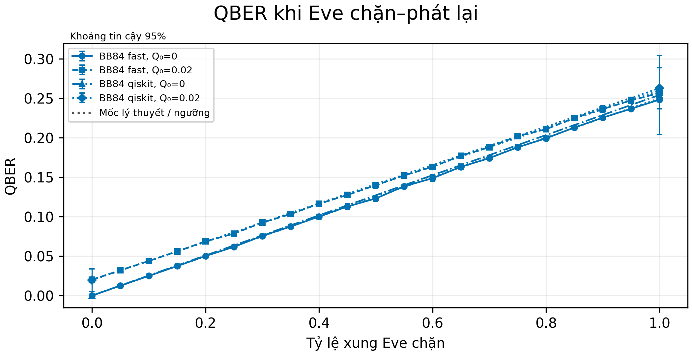

[CSV](E01_qber_eve.csv) · [PDF](E01_qber_eve.pdf) · [Nguồn gốc](E01_qber_eve.json)

### E02 — Dung sai nhiễu BB84

Cận Hoeffding làm phiên dừng sớm hơn ngưỡng QBER tiệm cận. Tỷ lệ dừng còn tính trường hợp độ dài khóa hữu hạn không dương. BB84 Qmax=0.08 dừng mọi lượt lần đầu tại Q=0.04. BB84 Qmax=0.11 dừng mọi lượt lần đầu tại Q=0.08.

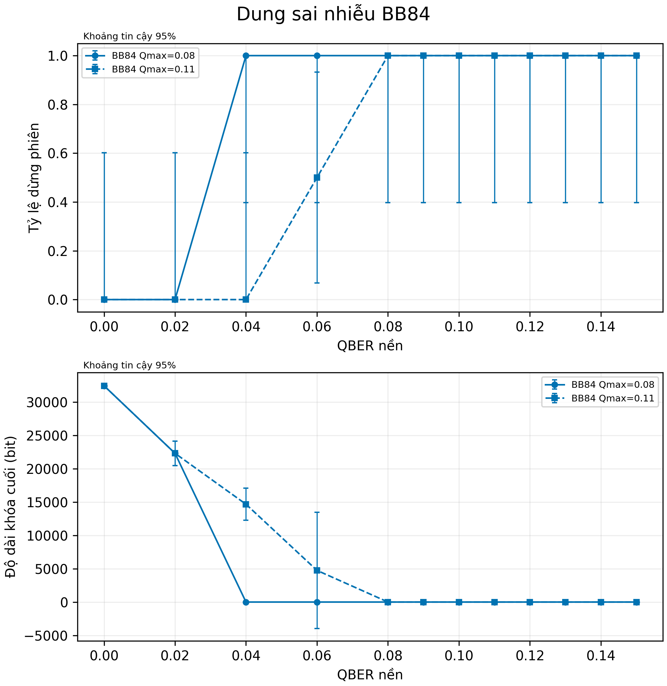

[CSV](E02_noise_abort.csv) · [PDF](E02_noise_abort.pdf) · [Nguồn gốc](E02_noise_abort.json)

### E03 — Phát hiện Eve qua mẫu công khai

Báo phát hiện khi mẫu lý tưởng có ít nhất một bit sai. Phép thử này dùng mô hình nhị thức với Eve chặn toàn phần. Có 0/6 điểm có mốc nằm ngoài khoảng tin cậy riêng lẻ. Các khoảng chưa hiệu chỉnh cho nhiều phép so sánh.

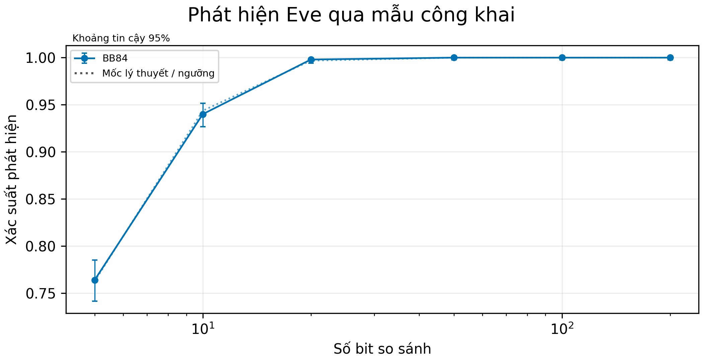

[CSV](E03_sample_detection.csv) · [PDF](E03_sample_detection.pdf) · [Nguồn gốc](E03_sample_detection.json)

### E04 — Các bước tạo khóa BB84

Sàng lọc giữ số bit đo được. Các bước sau ghi không bit khi phiên dừng. Hệ số Cascade chỉ tính trên các phiên hiệu chỉnh có entropy mẫu dương. Độ dài cuối được tính từ lượng rò quan sát và chi phí xác minh. BB84 Q=0.01 có 0 bước giảm độ dài trung bình trên lưới. BB84 Q=0.03 có 0 bước giảm độ dài trung bình trên lưới. BB84 Q=0.05 có 0 bước giảm độ dài trung bình trên lưới. BB84 Q=0.08 có 0 bước giảm độ dài trung bình trên lưới.

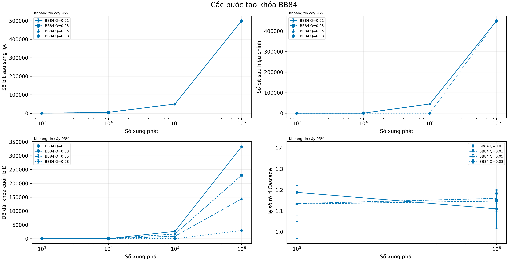

[CSV](E04_key_pipeline.csv) · [PDF](E04_key_pipeline.pdf) · [Nguồn gốc](E04_key_pipeline.json)

### E05 — Tổn thất do khóa hữu hạn

Mốc tiệm cận có cùng tỷ lệ sàng lọc và tỷ lệ bit công khai. Cận QBER, thẻ xác minh và ngân sách bí mật làm giảm tốc độ khóa hữu hạn. Tại N=1000000, tốc độ đo là 0.2398, mốc tiệm cận là 0.275 bit/xung.

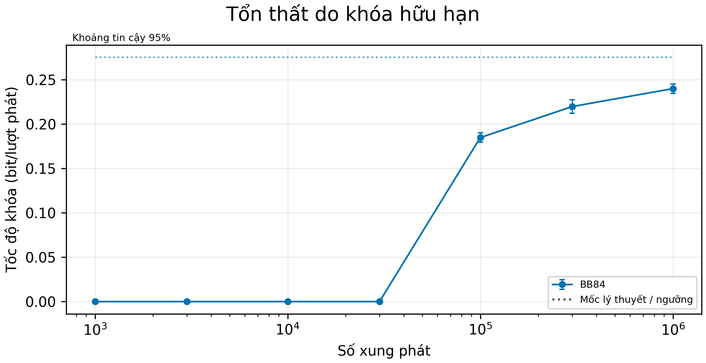

[CSV](E05_finite_key.csv) · [PDF](E05_finite_key.pdf) · [Nguồn gốc](E05_finite_key.json)

### E06 — Tốc độ khóa theo chiều dài sợi

Đường tiệm cận dùng mô hình suy hao và đếm tối, khoảng cách tính theo mỗi nhánh. Đường BB84 xung yếu là ước lượng lạc quan bỏ qua PNS. Đường mồi dùng cận chân không + mồi yếu. E91 tính theo cặp phát. Mô hình BB84 WCP cho điểm triệt tiêu khoảng 205.40 km. Mô hình BB84 decoy cho điểm triệt tiêu khoảng 194.88 km. Mô hình E91 cho điểm triệt tiêu khoảng 204.13 km.

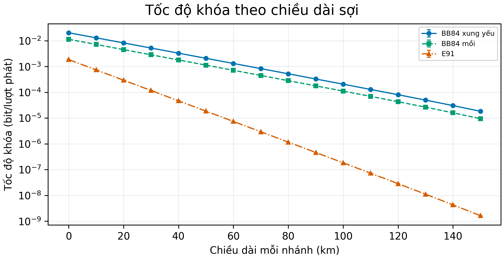

[CSV](E06_distance.csv) · [PDF](E06_distance.pdf) · [Nguồn gốc](E06_distance.json)

### E07 — Kiểm định Bell của E91

Cổng Bell dùng cận dưới CHSH và ngưỡng 2. QBER lấy từ toàn bộ cặp giữ khóa. Chặn–phát lại Z/X toàn phần làm giảm tương quan còn một nửa. Có 5/32 điểm có mốc nằm ngoài khoảng tin cậy riêng lẻ. Các khoảng chưa hiệu chỉnh cho nhiều phép so sánh. Có 0/40 lượt Eve cho |S| > 2. Với V=1, E91 fast, Eve=0 cho S=2.8255. Với V=1, E91 fast, Eve=1 cho S=1.4293. Với V=1, E91 qiskit, Eve=0 cho S=2.8192. Với V=1, E91 qiskit, Eve=1 cho S=1.4767.

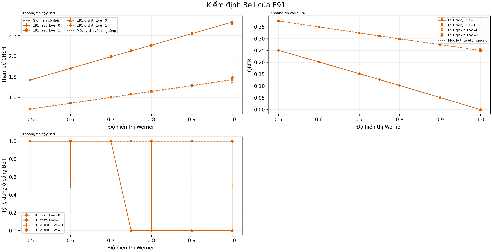

[CSV](E07_chsh.csv) · [PDF](E07_chsh.pdf) · [Nguồn gốc](E07_chsh.json)

### E08 — So sánh BB84 và E91

Tỷ lệ sàng lọc tính trên lượt dò hoặc cặp trùng phùng. Tỷ lệ dừng bao gồm toàn bộ quy trình. Cột bell_rejections đếm các lượt E91 dừng tại cổng Bell. Tốc độ tính cả các phiên không tạo khóa. Thời gian đo trên backend NumPy với EC lý tưởng. BB84 dùng nguồn đơn photon và đồng bộ cơ sở phát–đo. E91 cần nguồn cặp rối, hai nhánh quang và đo trùng phùng để ước lượng CHSH. E6 so sánh mô hình tốc độ theo khoảng cách. Có 0/28 điểm có mốc nằm ngoài khoảng tin cậy riêng lẻ. Các khoảng chưa hiệu chỉnh cho nhiều phép so sánh.

So sánh tại xác suất lật bit nền 0.

| Giao thức | Sàng lọc | Phiên dừng | Bit/lượt phát | ms/phiên |
|---|---:|---:|---:|---:|
| BB84 Eve=0 | 49.96% | 0.00% | 0.3234 | 54.7 |
| BB84 Eve=1 | 50.03% | 100.00% | 0 | 67.3 |
| E91 Eve=0 | 22.06% | 0.00% | 0.123 | 23 |
| E91 Eve=1 | 22.06% | 100.00% | 0 | 26.7 |

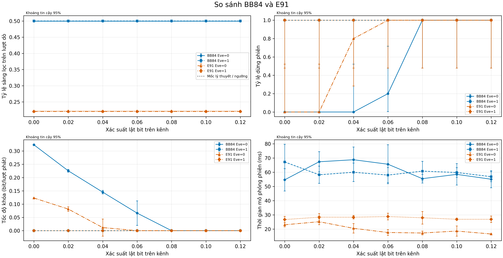

[CSV](E08_protocol_comparison.csv) · [PDF](E08_protocol_comparison.pdf) · [Nguồn gốc](E08_protocol_comparison.json)

### E09 — Hiệu năng mã hóa tệp QKDH

Trung vị và IQR tính sau một lượt làm nóng cho từng cấu hình. Phép đo gồm I/O tệp, HKDF và chia khối. Hỗ trợ AES-NI và tải máy ảnh hưởng kết quả.

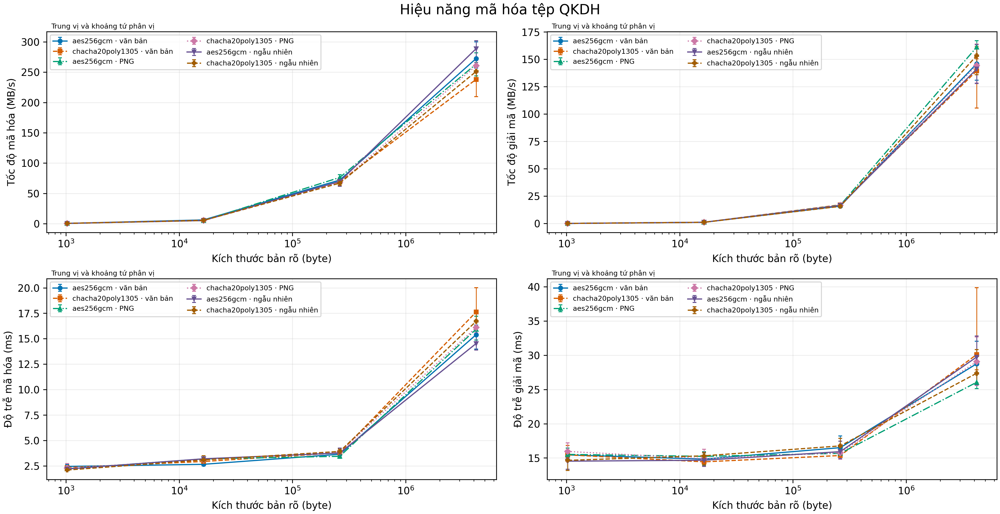

[CSV](E09_cipher_benchmark.csv) · [PDF](E09_cipher_benchmark.pdf) · [Nguồn gốc](E09_cipher_benchmark.json)

### E10 — Quy trình phân phối khóa và mã hóa tệp

Mỗi lượt dùng một phiên BB84 có HMAC. Đối chiếu SHA-256 trên tệp đã giải mã. Thời gian mã hóa và giải mã chỉ tổng hợp các phiên đã tạo khóa. Số lượt ghi nhận theo điều kiện. aes256gcm / text 3/3 · chacha20poly1305 / text 3/3 · aes256gcm / PNG 3/3 · chacha20poly1305 / PNG 3/3 · aes256gcm / random 3/3 · chacha20poly1305 / random 3/3.

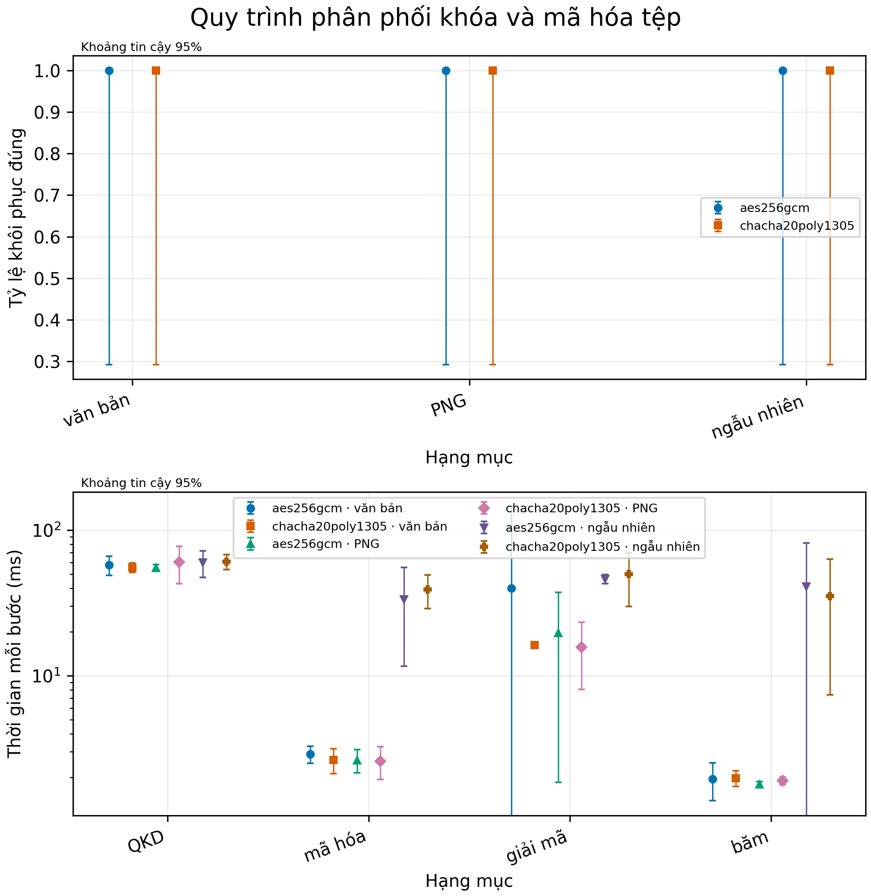

[CSV](E10_end_to_end.csv) · [PDF](E10_end_to_end.pdf) · [Nguồn gốc](E10_end_to_end.json)

### E11 — Toàn vẹn dữ liệu và tái sử dụng nonce

Mỗi lỗi sửa tệp được thử độc lập. Thí nghiệm cố ý lặp nonce trên dữ liệu giả để kiểm tra XOR bản rõ. Không lặp nonce trong sử dụng thực tế. Số lượt ghi nhận theo điều kiện. aes256gcm / header 30/30 · aes256gcm / ciphertext 30/30 · aes256gcm / tag 30/30 · aes256gcm / truncate 30/30 · aes256gcm / reorder 30/30 · aes256gcm / nonce reuse 30/30 · chacha20poly1305 / header 30/30 · chacha20poly1305 / ciphertext 30/30 · chacha20poly1305 / tag 30/30 · chacha20poly1305 / truncate 30/30 · chacha20poly1305 / reorder 30/30 · chacha20poly1305 / nonce reuse 30/30.

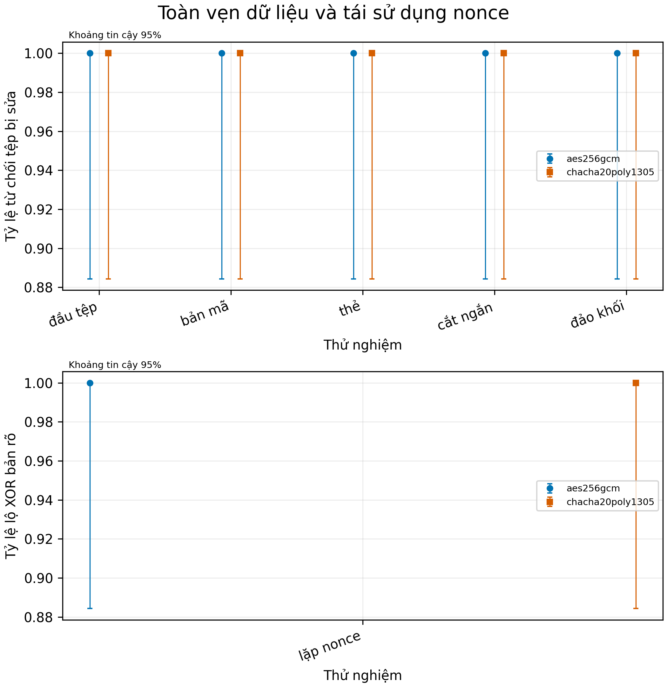

[CSV](E11_tamper.csv) · [PDF](E11_tamper.pdf) · [Nguồn gốc](E11_tamper.json)

### E12 — Xác thực kênh cổ điển

Eve chạy hai liên kết với hai đầu cuối. Cột both_tags_rejected đếm số lượt cả hai bên từ chối thẻ HMAC do Eve tạo. Số lượt ghi nhận theo điều kiện. BB84 / no HMAC 30/30 · BB84 / HMAC 0/30.

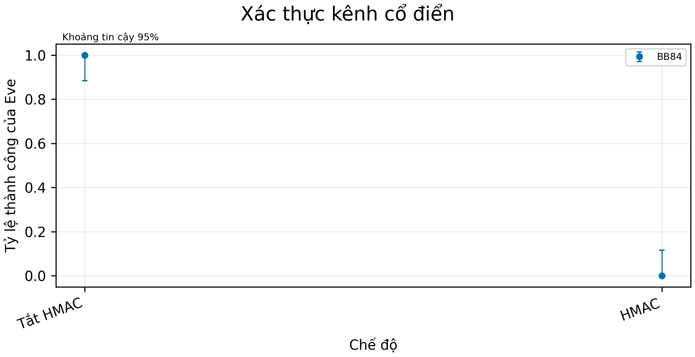

[CSV](E12_classical_mitm.csv) · [PDF](E12_classical_mitm.pdf) · [Nguồn gốc](E12_classical_mitm.json)

### E13 — Hiệu năng bộ giám sát

ROC quét ngân sách α hoặc ngưỡng Qmax. CI dùng cỡ mẫu cố định cho cùng giả thuyết thiết kế và mục tiêu α/β. Độ trễ chỉ tính ở lượt báo động kể từ bit đầu. Eve thích nghi dời toàn bộ lượt chặn về cuối, giữ tỷ lệ chặn trung bình. Ở điểm thiết kế, ci · Q₀=0.01 dùng trung bình 190.0 bit và báo động 200/200 lượt. Ở điểm thiết kế, sprt · Q₀=0.01 dùng trung bình 53.3 bit và báo động 199/200 lượt. Ở điểm thiết kế, ci · Q₀=0.03 dùng trung bình 437.0 bit và báo động 200/200 lượt. Ở điểm thiết kế, sprt · Q₀=0.03 dùng trung bình 140.4 bit và báo động 199/200 lượt. Mẫu ít lượt cần xét khoảng tin cậy trước khi so tỷ lệ lỗi.

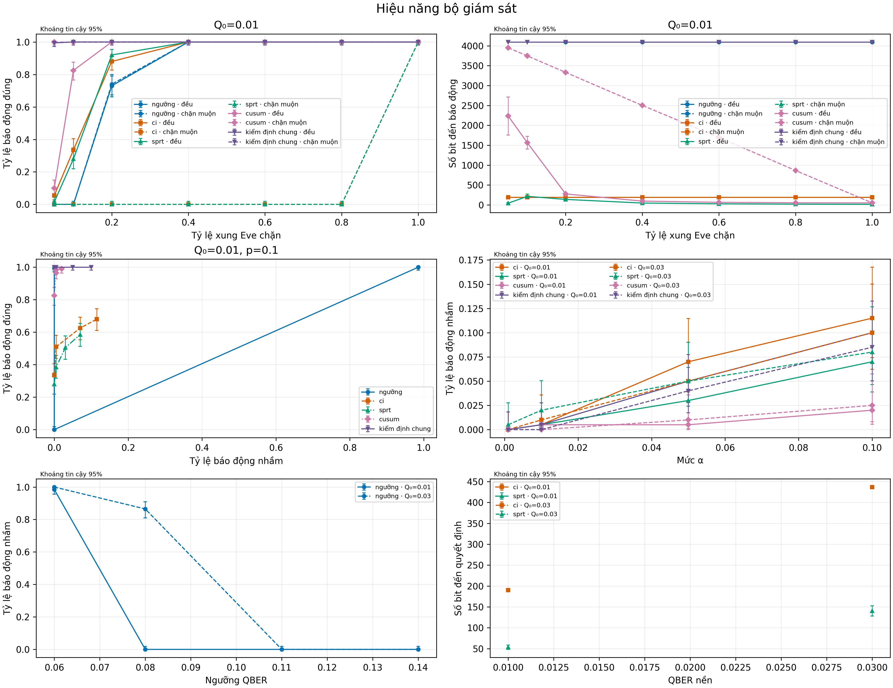

[CSV](E13_detectors.csv) · [PDF](E13_detectors.pdf) · [Nguồn gốc](E13_detectors.json)

### E14 — Chẩn đoán ngẫu nhiên trên chuỗi bit

SP 800-22 đo sai lệch trong mẫu. Aer lấy mẫu giả ngẫu nhiên qua mạch Hadamard. Một số phép thử có thể trượt ở mức α ngay trên nguồn không lệch. Có 0/25 điểm có mốc nằm ngoài khoảng tin cậy riêng lẻ. Các khoảng chưa hiệu chỉnh cho nhiều phép so sánh. Có 196/200 phép thử riêng lẻ đạt ngưỡng.

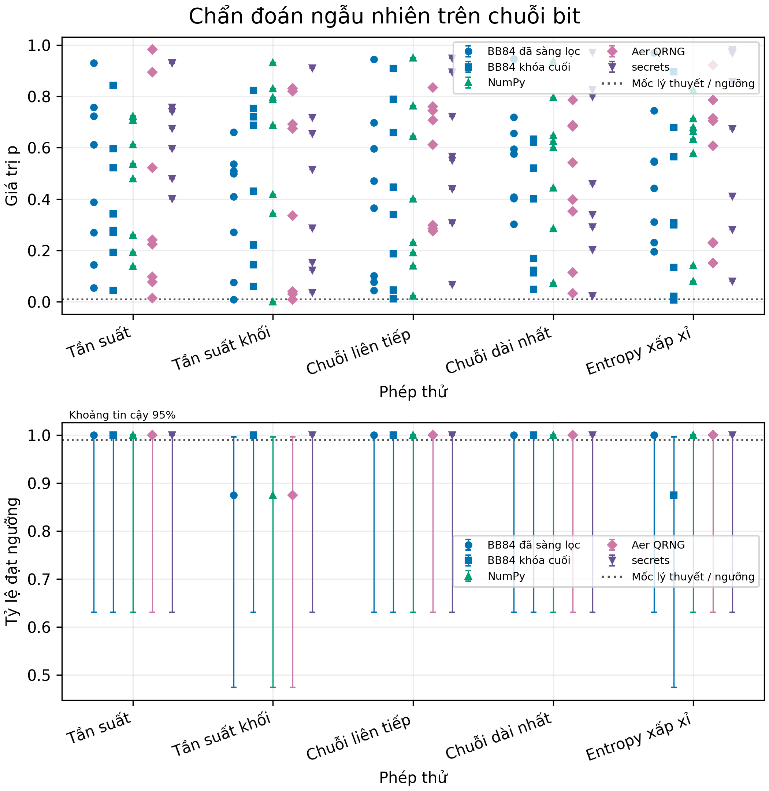

[CSV](E14_randomness.csv) · [PDF](E14_randomness.pdf) · [Nguồn gốc](E14_randomness.json)

### E15 — Chi phí tìm khóa cổ điển và lượng tử

Các hàng Grover ghi số mũ truy vấn tìm khóa. Các hàng Shor ghi mô hình đa thức và để trống số mũ. Chi phí cổng, độ sâu và sửa lỗi cần mô hình riêng.

| Thuật toán | Cỡ khóa (bit) | An toàn cổ điển (bit) | Tấn công lượng tử | Mô hình chi phí |
|---|---:|---:|---|---|
| AES-128 | 128 | 128 | Grover | Bậc 2^64 truy vấn |
| AES-256 | 256 | 256 | Grover | Bậc 2^128 truy vấn |
| ChaCha20 | 256 | 256 | Grover | Bậc 2^128 truy vấn |
| RSA-2048 | 2048 | 112 | Shor | Đa thức |
| ECC P-256 | 256 | 128 | Shor | Đa thức |

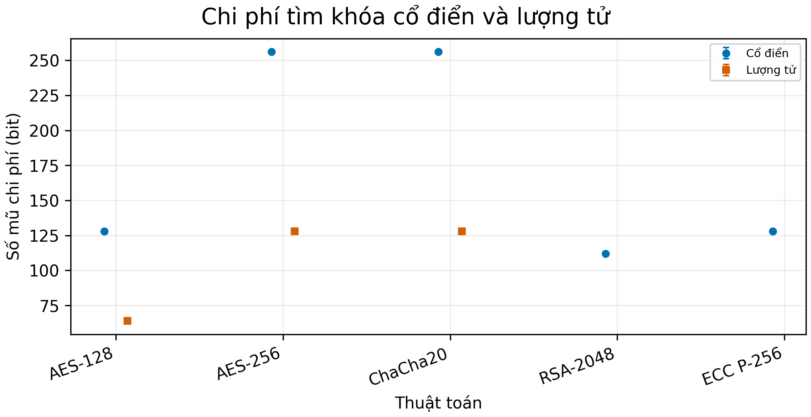

[CSV](E15_quantum_security.csv) · [PDF](E15_quantum_security.pdf) · [Nguồn gốc](E15_quantum_security.json)

## 7. Phân tích bảo mật và giới hạn

- Thí nghiệm mô hình hóa thiết bị và kênh. Số liệu QBER, CHSH và tốc độ khóa đến từ mô phỏng. D1 dùng mạng loopback để vận chuyển thông điệp, với kênh lượng tử mô phỏng trong tiến trình.
- Giả định nguồn đơn photon loại trừ PNS trong các quét cơ sở. Nguồn kết hợp yếu có thành phần đa photon. E6 chỉ đánh giá tiệm cận bằng trạng thái mồi và giả định đáp ứng detector. PNS và giao thức trạng thái mồi đầy đủ là công việc tiếp theo. [Ma và cộng sự](https://arxiv.org/abs/quant-ph/0503005)
- Công thức khóa hữu hạn giản lược cần thêm các giả thiết và ngân sách sai số để có chứng minh khả hợp cho tấn công tổng quát. Kiểm tra CHSH trong E91 phụ thuộc mô hình dò và chọn trùng phùng. [Tomamichel và cộng sự](https://arxiv.org/abs/1103.4130)
- Detector blinding, Trojan-horse và kênh kề thời gian chỉ được thảo luận. Thiết bị thực cần đánh giá nguồn, detector, quang học và triển khai mạng.
- Xác thực cổ điển cần khóa chia sẻ ban đầu. QKD mở rộng khóa, còn HMAC dựa trên giả định an toàn tính toán. E12 dùng hai liên kết để quan sát hậu quả khi bỏ xác thực.
- Seed mô phỏng có thể dự đoán. Khóa dẫn xuất từ mô phỏng có seed dự đoán được không an toàn trong thực tế. Ngẫu nhiên vật lý và quản lý khóa là các vấn đề riêng của triển khai.
- Tính toàn vẹn AEAD phụ thuộc nonce duy nhất theo khóa, giới hạn sử dụng và xử lý lỗi. Đo benchmark trên một máy chỉ phản ánh môi trường chạy đã ghi. Các giá trị SP 800-22 là chẩn đoán thống kê cho mẫu đã đo. [NIST SP 800-38D](https://csrc.nist.gov/pubs/sp/800/38/d/final) · [NIST SP 800-22](https://csrc.nist.gov/pubs/sp/800/22/r1/upd1/final)

## 8. Kết luận và hướng phát triển

Tổng hợp mức khớp với mô hình ở E1–E8, đánh đổi giữa độ trễ và xác suất phát hiện ở E13, yêu cầu xác thực từ E12 và tính toàn vẹn tệp ở E10–E11. Giải thích các trường hợp sai khác theo cỡ mẫu, nhiễu nền, lượng rò hiệu chỉnh và thiết lập thí nghiệm. Các hướng mở rộng gồm PNS và giao thức mồi đầy đủ, BB84/E91 lai, xác thực Wegman–Carter và kết hợp QKD với ML-KEM.
